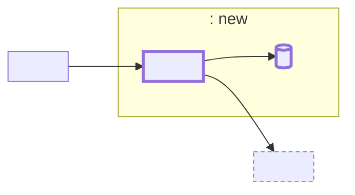
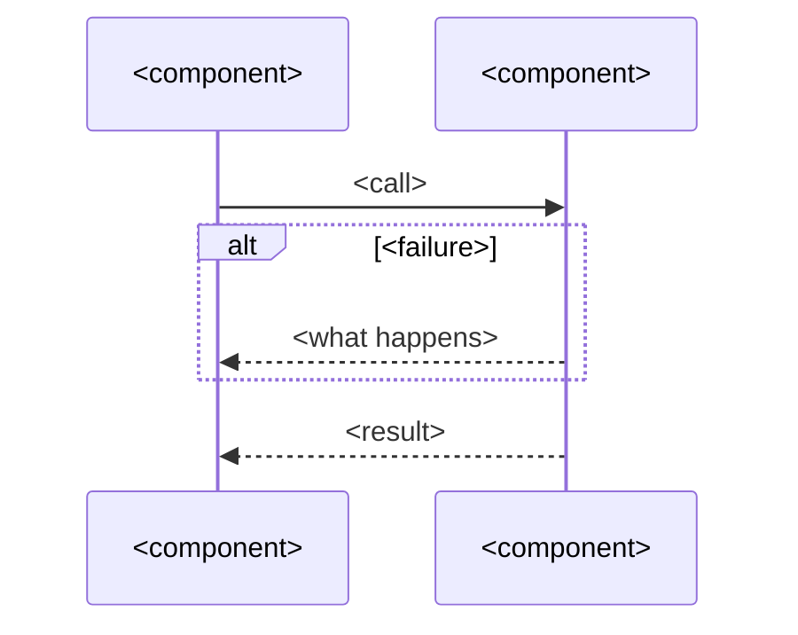

# Shape doc template

The doc has two layers. The first screen (pitch, Terms, Overview) gives a reader the whole solution in about a minute; the sections after it are reference. Sections a reader reads through (Overview, module sentences) are prose; sections a reader looks things up in (Terms, Components, failures, Alternatives, Not building, Open questions) are lists.

Keep the prose under about 60 lines; diagrams don't count. If it runs over, trim Alternatives considered and Not building first. Use the shape's own vocabulary throughout. List items open with a bold label and a spaced hyphen: `**Label** - text`.

````md
# <Feature> solution shape

<The pitch: one or two plain sentences on what changes and why.>

## Terms

<!-- Domain ideas a teammate new to this area wouldn't know; components get their own section. Leave out if there are none. -->

- **<term>** - <meaning in this domain>.

## Overview

<The main path in three to five sentences: what triggers it, which component does what, and what passes between them, using the terms above. No failures; those go under Sequence.>



Thick border: new or changed. Dashed: exists today. Labeled arrows are the seams.

## Components

**<module>** (<new | changed | existing>) <one sentence on what the module is responsible for>.

- **<component>** - <what it owns, plus anything the diagram can't show: purity, who logs, lifetime, source of truth>.

## Sequence



When things go wrong:

- **<Phase>** - <each failure or degraded result at this step, and what happens to the work in flight>.

## Alternatives considered

- **<Option>** - <why it was ruled out.>

## Not building

- **<Item>** - <what would make it worth building.>

## Open questions

- <Question> Owner: <named person, team, spike, or planning>.
````
